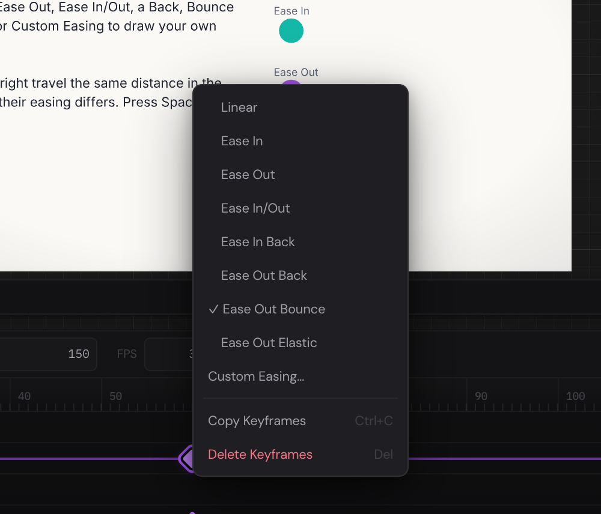

Easing is how a value gets from one keyframe to the next: at an even speed,
starting slowly, slowing to a stop, overshooting, bouncing. Good easing is
much of what makes movement feel alive. This chapter shows you how to choose
an easing for each keyframe, how to draw one of your own, and how to work
with the animation as curves in the graph editor.

## Choose a keyframe's easing {#choose}

1. On the timeline, right-click a keyframe's diamond.
2. Choose an easing from the top of the menu. A tick marks the one the
   keyframe has.

| Easing               | How the move goes                                             |
| -------------------- | ------------------------------------------------------------- |
| **Linear**           | At the same speed all the way, starting and stopping at once. |
| **Ease In**          | Starts slowly and speeds up.                                  |
| **Ease Out**         | Starts quickly and slows to a stop.                           |
| **Ease In/Out**      | Slow at both ends, quickest in the middle.                    |
| **Ease In Back**     | Draws back a little before it sets off.                       |
| **Ease Out Back**    | Goes a little past the end, then settles back.                |
| **Ease Out Bounce**  | Bounces at the end, like a ball dropped on the floor.         |
| **Ease Out Elastic** | Springs past the end and wobbles into place.                  |

The easing of a keyframe shapes the move that arrives at it, from the
keyframe before. To make a shape slow down as it reaches frame 60, give the
keyframe at frame 60 **Ease Out**. Keyframes you set yourself start as
**Linear**.

The easing goes to every selected keyframe, so you can ease many at once:
select them (on a layer's name, right-click and choose **Select Keyframes**
for all of its keyframes), then right-click one of them.

> [!TIP]
> Tutorial 7 · Timing has a page that shows five easings side by side: five
> balls travel the same way in the same time, and only their easing differs.
> Press [[Space]] to compare them.

## Draw your own easing {#custom}

1. Right-click a keyframe's diamond and choose **Custom Easing…**.
2. The Easing Editor opens. Its curve runs from the start of the move, at
   the bottom left, to the end, at the top right: time goes across and how
   far the move has got goes up. A dot below the curve keeps playing the move
   with this easing.
3. Drag the curve's two handles to shape it, or type their positions in
   **X1**, **Y1**, **X2** and **Y2**. An **X** stays between 0 and 1; a **Y**
   above 1 or below 0 makes the move overshoot.
4. Or click one of the easings below the curve, in five groups: **CSS
   Standard**, **Power**, **Expo & Circ**, **Back**, and **Elastic & Bounce**.
5. Close the editor with its **×**, with [[Esc]], or by clicking outside it.

Each change goes to the keyframes at once (a handle's when you let go of
it). When a keyframe's easing isn't one of those on its menu, the menu ticks
**Custom Easing…**.

The curve has handles to drag, and numbers in **X1** to **Y2**, when it's a
curve of your own, a **CSS Standard** curve, or **In Quad**, **Out Quad**,
**In Cubic**, **Out Cubic**, **In Back** or **Out Back**. The others, the
**In Out** ones among them, are worked out another way that no pair of
handles can draw: their fields are empty and greyed, and a note under them
says so. To adjust one of those, start from a curve with handles that's
close to it.

## The graph editor {#graph-editor}

The graph editor shows the animation as curves: time goes across, and each
property's value goes up and down. Where the timeline shows when keyframes
are, the graph shows how values change between them.

Press [[G]], or click **Graph editor** on the timeline's bar, to swap the
rows of keyframes for the graph. Press [[G]] again to go back.

1. **The property list:** each selected layer and its animated properties,
   each with the color of its curve.
2. **The curves,** one for each property.
3. **A selected keyframe** and its handles.

It shows the properties that are numbers — position, size, rotation,
opacity and the like — of the selected layers, or of every animated layer
when nothing is selected. Colors aren't shown as curves.

### Choose which curves to see {#property-list}

Click a property in the list to see only its curve. Click others to add
them. Click a property you're seeing again to hide it; when none is chosen,
you see them all.

### Move around {#graph-view}

- **Zoom in time:** scroll.
- **Zoom the values:** hold [[Mod]] and scroll.
- **Move the view:** [[Alt]]-drag, or drag with the middle mouse button.
- **Fit everything in:** double-click an empty part of the graph.
- **Go to a frame:** click an empty part of the graph. The playhead goes to
  that frame.

### Select and change keyframes {#graph-keyframes}

- **Select:** click a keyframe's dot. [[Shift]]-click to add more, or drag a
  box around some on an empty part of the graph.
- **Change its frame and value:** drag it. It keeps to whole frames. Hold
  [[Shift]] to move it only across (in time) or only up and down (in value),
  whichever way you start.
- **Nudge:** [[Left]] and [[Right]] move the selected keyframes a frame,
  [[Up]] and [[Down]] change their value by 1. Hold [[Shift]] for 10.
- **Delete:** press [[Delete]] or [[Backspace]].

The keys work while the graph has the focus: click in it first.

Keyframes made by an Animation Sequence step are hollow dots. Clicking one
opens its step in the Animation Sequence window, where you change it (see
[How steps become keyframes](presets-and-sequences.md#keyframes)).

### Bend a curve with its handles {#handles}

Select a keyframe and handles appear beside it for the curves that have
them: the handle before it shapes the curve arriving at it, the one after it
the curve leaving it. Drag a handle to bend that curve; the easing changes
as if you'd drawn it in the Easing Editor, starting from the curve it had. A
curve between two keyframes with the same value stays flat.

Of the easings on the keyframe menu, **Linear**, **Ease In**, **Ease Out**,
**Ease In Back** and **Ease Out Back** have handles. **Ease In/Out**,
**Ease Out Bounce** and **Ease Out Elastic** don't: to bend one of those,
right-click it on the timeline, choose **Custom Easing…**, and pick
**Ease In Out** from **CSS Standard**, say, which has handles.

## How rotation turns {#rotation}

Rotation goes through every degree between its keyframes, the way you typed
them:

- From 0° to 360°, a layer spins round once; to 720°, twice.
- From 0° to −90°, it turns a quarter the other way.
- From 350° to 10°, it turns back 340°. To go forward the short way, key
  370° instead.

Type any number of degrees into **Rotation** in the Properties panel.
