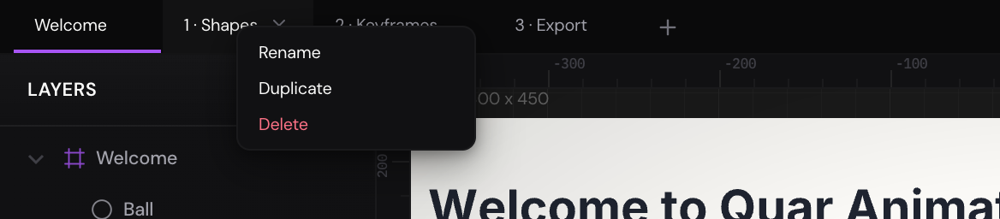

Quar Animator runs in your web browser: there's nothing to install and no
account to make. This chapter shows you around — the Projects page, the
editor's parts, pages — and how to keep your work safe with saving, backups
and undo. It ends with where to find help.

## Open Quar Animator {#open}

Go to Quar Animator's address in a desktop browser. The free editor is at
[free.quar.pro](https://free.quar.pro).

The editor needs a window at least 768 pixels wide. On a phone or a small
tablet you see a note asking for a larger screen instead.

The first time you visit, two notes greet you: one says your work stays on
your device, the other that Quar Animator is in beta. Read them, then click
**Got it** on each. The first also has an **Enable Google Fonts** box,
unticked to begin with (see [Fonts and Google](troubleshooting.md#google-fonts)).

> [!NOTE]
> The free editor keeps your projects in this browser, on this computer, and
> sends them nowhere. That also means nobody else can bring them back if
> they're lost, so read [Keep a backup](#backups) before long.

## The Projects page {#projects-page}

Quar Animator opens on the Projects page. It lists everything you've saved and
the tutorials.

- **Your Projects** shows the projects you've saved, the one saved last first,
  each with a picture of it and the date. Click a project to open it.
- **New Project** starts an empty project (see
  [Start a new project](#new-project)).
- **Tutorials** are seven short projects that teach the editor, a lesson on
  each page. They're added on your first visit, and they're yours to change.
- At the top right are links to Quar Animator on GitHub, TikTok and Facebook,
  the appearance button (a sun or a moon; see [Light or dark](#appearance))
  and **Import .quar** (see [Keep a backup](#backups)).
- At the foot of the page: this guide, the privacy policy and the terms.

To rename a project, double-click its name, type the new one and press
[[Enter]]. [[Esc]] keeps the old name.

To delete a project, point at its card, click the bin that appears, and click
it again within three seconds to confirm.

> [!CAUTION]
> A deleted project is gone for good. Only the tutorials come back:
> **Help › Restore Tutorials** in the editor adds the ones you deleted.

## Start a new project {#new-project}

1. On the Projects page, click **New Project**. The editor opens on an empty
   canvas, with one page, Page 1, and the project called Untitled Project.
2. Press [[R]] for the Rectangle tool (or click it in the toolbar at the top).
3. Drag on the canvas. When you let go, the rectangle is there, selected, and
   the editor is back on the Selection tool ([[V]]), ready to move it.

To name the project, click **Untitled Project** at the top right, type a name
and press [[Enter]].

A new project isn't saved until you save it: see
[Save your work](#saving).

To start another new project from inside the editor, choose
**File › New Project**. If there are changes you haven't saved, the editor asks
before it discards them.

## Find your way around {#layout}

1. **The menu bar.** The logo at the far left takes you back to the Projects
   page. The menus come after it: File, Edit, View, Animation, Rigging, Export
   and Help. The tools are in the middle: Selection,
   Direct Selection, Hand, the shapes, Pen, Brush, Eraser, Text, Artboard and
   Bone. Point at a tool to see its name and its one-key shortcut. When the
   page has an artboard, a play button after the tools
   [presents the artboards](presenting.md#present) full screen. The project's
   name is on the right.
2. **Page tabs.** A project has one page or more: see [Pages](#pages).
3. **Layers.** Everything on the page, the topmost first. Click a layer to
   select it (see [The Layers panel](selecting-and-arranging.md#layers)). The
   symbols you make are listed below.
4. **The canvas**, where you draw and arrange. Scroll to zoom in and out
   around the pointer, and hold [[Space]] and drag to move around.
   [[Mod+0]] fits the artwork in the window, [[Mod+1]] shows it at 100%. The
   bar along the bottom shows where the pointer is and how far you've zoomed.
5. **Properties.** The settings of what's selected: its position and size,
   its fill and stroke, its effects, the animation presets. With nothing
   selected, it shows the document's background color.
6. **The timeline.** It plays the animation and holds its keyframes, a row for
   each layer, with the sound lane below them. Press [[Space]] to play and to
   pause. Drag its top edge to make it taller or shorter. See
   [The timeline](keyframes.md#timeline).

> [!TIP]
> **Help › Keyboard Shortcuts** lists the main shortcuts, and
> [Keyboard shortcuts](shortcuts.md) all of them. Tools have one-key
> shortcuts that work as long as you're not typing in a field.

## Pages {#pages}

A project can hold several pages, each with its own layers, timeline and undo
history: a scene on each, or a lesson on each, as the tutorials do. The tabs
above the canvas are the pages.

- **Add a page:** click **+** after the last tab. New pages are called Page 2,
  Page 3 and so on.
- **Go to a page:** click its tab.
- **Rename a page:** double-click its tab (or right-click it and choose
  **Rename**), type the name and press [[Enter]].
- **Copy a page:** right-click its tab and choose **Duplicate**.
- **Delete a page:** point at its tab and click the **×**, then click it again
  within three seconds. Or right-click the tab and choose **Delete**. A project
  always keeps at least one page.

> [!CAUTION]
> Deleting a page can't be undone. If you might want it back, download a
> backup first (see [Keep a backup](#backups)).

## Save your work {#saving}

To save, press [[Mod+S]] or choose **File › Save**. "Project saved" appears at
the bottom right, and the project is on the Projects page under Your Projects.

A dot before the project's name means there are changes you haven't saved.

Once a project has been saved, the editor saves it again by itself every 30
seconds while there are changes. A new project is only saved when you save it
the first time.

To keep the project as it is and carry on in a copy, choose
**File › Save As…** ([[Mod+Shift+S]]) and name the copy. From then on you're
working in the copy.

To open another project, choose **File › Open Project…** ([[Mod+O]]), or go
back to the Projects page: click the logo at the far left of the menu bar, or
choose **File › Back to Projects**.

If there are changes you haven't saved, the editor asks before anything takes
the project's place: a new project, another one opened or imported, going back
to the Projects page. **Discard** lets the changes go; **Cancel** keeps you
where you are, so you can save first. Your browser asks too before you close
the tab or reload it.

### Where your projects are kept {#storage}

The free editor saves your projects in your browser's storage on this
computer. So:

- They're in this browser only. Another browser, another computer or a private
  window doesn't have them, and what you save in a private window goes when you
  close it.
- Clearing this site's data in your browser (its cookies and site data)
  deletes them.

If a save fails, see [When saving fails](troubleshooting.md#saving).

## Keep a backup {#backups}

A backup is a `.quar` file on your computer, with the whole project in it:
every page and its animation, the symbols, the pictures and the sounds.

1. Choose **File › Download as .quar**.
2. Your browser saves it to your downloads, named after the project:
   `My first animation.quar`, say.

To open a `.quar` file, your backup or one someone sent you, do one of these:

- On the Projects page, click **Import .quar** and choose the file.
- In the editor, choose **File › Import .quar…**, or drop the file on the
  canvas.

It opens in the editor as a project of its own, saved beside the ones you
have.

> [!TIP]
> Download a backup of work you care about now and then, and always before you
> clear your browser's data. A `.quar` file is also how you take a project to
> another browser or computer.

## Undo and redo {#undo}

- **Undo:** [[Mod+Z]], or **Edit › Undo**.
- **Redo:** [[Mod+Shift+Z]] or [[Mod+Y]], or **Edit › Redo**.

Undo works wherever you are in the editor, except while you're typing in a
field: there it undoes your typing.

Each page keeps its own history, up to the last 50 changes. The history starts
afresh when you open or start a project, and isn't kept when you reload.

## Light or dark {#appearance}

The editor is dark unless you choose otherwise. To switch:

- In the editor, choose **View › Light Appearance**. Choose it again to go back
  to dark.
- On the Projects page, click the sun (or, in the light appearance, the moon)
  at the top right.

Your choice is remembered in this browser, and this guide follows it.

The color behind the artwork belongs to the document, not to the appearance:
to change it, select nothing and set **Background** under **Document** in the
Properties panel (see [The background](shapes.md#background)).

## Get help {#help}

- **Help › User Guide**, or [[F1]], opens this guide beside the canvas. (On a
  Mac laptop you may need to hold [[Fn]] for [[F1]].) Move it by its title bar
  and resize it from its left edge or its bottom-right corner; it opens where
  you left it. Its buttons go back, show the contents, open the page in a tab
  of its own and close it. [[Esc]] closes it too.
- **Help › Keyboard Shortcuts** lists the main shortcuts.
- **Help › Restore Tutorials** brings back tutorials you've deleted.
- **Help › Report Issues** opens Quar Animator's issues on GitHub, where you
  can tell us about a problem.

The guide is on the web too, linked from the foot of the Projects page.
