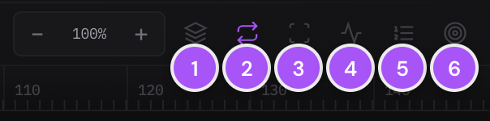
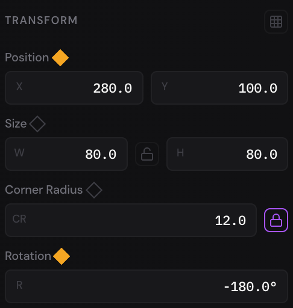
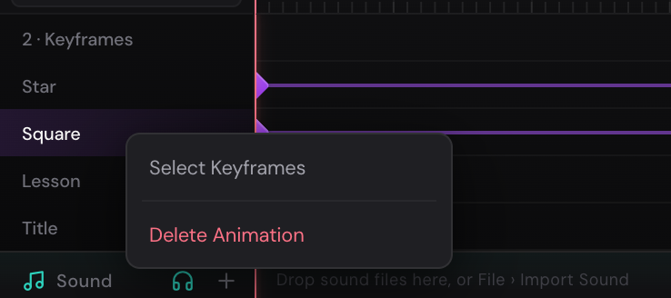

Animation in Quar Animator is made of keyframes. A keyframe holds a value of
one property — a layer's position, its rotation, its fill color — at one
frame, and the editor works out every frame in between. This chapter shows
you the timeline, how to set and change keyframes, how to play your work, and
how onion skin shows the frames around the one you're on.

## The timeline {#timeline}

The timeline is along the bottom of the editor.

1. **The transport buttons:** **Go to start**, **Previous frame**,
   **Play/Pause**, **Next frame** and **Go to end**.
2. **The time:** the playhead's frame, then the timeline's length, both in
   minutes, seconds and frames (`00:02:10` is 2 seconds and 10 frames).
3. **Frames and FPS:** how long the timeline is, and how many frames play
   each second (see [Frames and FPS](#frames-and-fps)).
4. **Zoom and the timeline's buttons:** zoom in and out on the frames, and
   the buttons described [below](#buttons).
5. **The timeline picker,** there when the page has an artboard: which
   artboard's timeline you see (see [Each artboard's timeline](#artboards)).
6. **The ruler and the playhead.** The red line is the playhead: the frame
   shown on the canvas.
7. **A row for each layer,** in the same order as the Layers panel, with the
   layer's keyframes on it. The selected layer's name is highlighted. A video
   layer's row also holds its clip (see [Video clips](#video-clips)).
8. **The Sound lane,** where sound clips go, a video's sound among them (see
   [Sound](sound.md)).

### The timeline's buttons {#buttons}

1. **Auto-keyframe** ([[K]]): every change you make sets a keyframe (see
   [Auto-keyframe](#auto-keyframe)).
2. **Loop** ([[L]]): playing starts over when it reaches the end. It's on
   unless you turn it off.
3. **Work area** ([[Alt+W]]): plays only part of the
   timeline (see [The work area](#work-area)).
4. **Graph editor** ([[G]]): shows the keyframes as curves instead (see
   [Easing and the graph editor](easing.md)).
5. **Animation Sequence** ([[Shift+A]]): opens the Animation Sequence window
   (see [Presets and Animation Sequence](presets-and-sequences.md)).
6. **Onion skin:** click for its settings, right-click to turn it on or off
   (see [Onion skin](#onion-skin)).

A button is lit while what it turns on is on. Point at a button to see its
name and shortcut; all the timeline's keys are in
[Keyboard shortcuts](shortcuts.md#timeline).

### Make room for it {#resize}

- **Taller or shorter:** drag the timeline's top edge. Double-click the edge
  to bring back the usual height. The canvas always keeps some room above it,
  and the editor remembers the height in this browser.
- **Out of the way:** click the arrow at the left end of the timeline's bar.
  It shrinks to a thin bar that still has **Play**, the time, **Frames**,
  **FPS** and **Loop**. Click the arrow again to bring it back.

## Play your animation {#playing}

- **Play and pause:** press [[Space]], or click **Play/Pause**. Space works
  wherever you are, except while you're typing in a field. On the canvas it
  plays when you let go of it, unless you held it down to pan.
- **One frame at a time:** [[,]] goes back a frame, [[.]] goes forward one.
- **Ten frames at a time:** [[Shift+,]] and [[Shift+.]].
- **To the start:** [[Home]], or **Go to start**.
- **To the end of the animation:** [[End]], or **Go to end**.

The **Animation** menu has all of these too, and **Loop Playback** and
**Auto-Keyframe**. Stepping works while the animation is stopped.

Playing doesn't run on to the end of the timeline: it stops at the last
keyframe, or at the end of the last sound or video clip if that's later.
With **Loop** on, it starts over from the beginning there. A timeline with no
keyframes, sounds or video clips plays to its end. [[End]], **Go to end**, **Animation › Go to End**
and **Go To End** on the ruler's right-click menu all take you to that same
last frame. **Go To Last Frame** on the ruler's menu goes to the timeline's
very last frame, past the end of the animation, say to key something after
it.

## Frames and FPS {#frames-and-fps}

- **Frames** is how long the timeline is. Type a number and press [[Enter]]
  (or click away); [[Esc]] keeps the old one. A new project's timeline is 300
  frames long: 10 seconds.
- **FPS** is the frame rate, from 1 to 120 frames per second. It's the same
  for the whole document: every page and every artboard plays at it.

**Edit › Undo** ([[Mod+Z]]) takes back a change to either. Undoing the frame
rate puts it back on every page.

Keyframes keep their frame numbers when you change the frame rate, so a
higher **FPS** plays the same animation faster and a lower one plays it more
slowly. That's how you change the speed of the whole animation. (GIF, MP4 and
WebM exports also have a [**Speed**](exporting.md#gif) setting of their own.)
Sounds and videos still start on the same frames, but play at their own
pace.

## The playhead and the ruler {#ruler}

The ruler above the rows is numbered in frames.

- **Go to a frame:** click it on the ruler.
- **Scrub:** drag the playhead's head, the red marker in the ruler, along
  it. The canvas follows.
- **Zoom:** click **+** and **−** beside the percentage, from 25% to 800%.
  Zoomed in, scroll sideways (or hold [[Shift]] and scroll) to move along the
  frames.

Right-click the ruler (or an empty part of a row) for **Go To Frame**,
**Add Opacity Keyframe at Frame** (for the selected layers), **Go To Start**,
**Go To End**, **Go To Last Frame** and the work area's commands. The frame you clicked on is in
their names.

### Play part of the timeline: the work area {#work-area}

The work area is a stretch of the timeline that playing keeps to, so you can
watch one move over and over.

1. Drag along the ruler from the first frame you want to the last. The work
   area is marked on the ruler and **Loop** turns on.
2. Press [[Space]]. Only the frames in the work area play.

To change it, drag its ends or its middle. [[I]] puts its start at the
playhead and [[Shift+I]] its end; so do **Set Work Area Start** and
**Set Work Area End** on the ruler's right-click menu. **Work area**
(or [[Alt+W]]) turns it off and on again, and
**Clear Work Area** on the ruler's menu takes it away. While it's on, [[Home]],
**Go to start**, **Animation › Go to Start** and **Go To Start** on the
ruler's menu go to its start.

## Animate with keyframes {#animate}

To move a shape across the page:

1. Select it.
2. Press [[Home]] to go to frame 0.
3. In the Properties panel, click the diamond beside **Position**. The diamond
   fills in, and a diamond appears on the layer's row at frame 0: its first
   keyframe.
4. Go to a later frame: press [[Shift+.]] a few times, or click the ruler.
5. Drag the shape to where it should be by then. Because **Position** has a
   keyframe already, moving it sets a second one at this frame.
6. Press [[Space]]. The shape travels between the two places.

Keyframes don't need to be on the same frames for every property: give
**Rotation** keyframes of its own, say, and the shape turns while it moves.

> [!TIP]
> It takes two keyframes to move. A property with one keyframe keeps that
> value all the way through, so set the starting keyframe first, then the
> later ones.

### The diamonds in Properties {#diamonds}

Each property that can be animated has a diamond beside its name: Position,
Size, Rotation, Opacity, the fill's and stroke's colors, corner radius, a
text's font size and more.

- **An empty gray diamond:** the property isn't animated.
- **An outlined diamond:** the property is animated, but has no keyframe at
  this frame. Its value here comes from the keyframes around it.
- **A filled diamond:** there's a keyframe at this frame.

Click an empty or outlined diamond to set a keyframe at the playhead with the
property's value as it is. Click a filled one to remove that keyframe.

Once a property has keyframes, changing it at another frame sets a keyframe
there: drag the layer, type a value, scrub a label. Change it on a frame that
has a keyframe and that keyframe takes the new value.

### Auto-keyframe {#auto-keyframe}

With **Auto-keyframe** on, every change you make to a layer sets a keyframe at
the playhead, whether the property was animated or not: move it, resize it,
turn it, recolor it. Turn it on and off with [[K]], the **Auto-keyframe**
button on the timeline, or **Animation › Auto-Keyframe**. It's off in a new
project.

## Work with keyframes on the timeline {#dope-sheet}

Each layer's row shows its keyframes as diamonds, whichever property they
belong to. One diamond stands for all the layer's keyframes on that frame:
key **Position** and **Rotation** on frame 30, and there's one diamond at
30 for both. A line joins a layer's keyframes where it changes between
them; where there's no line, it holds still.

- **Select keyframes:** click a diamond. That selects every keyframe it
  stands for. [[Shift]]-click to add more. Click an empty part of the rows
  to select none.
- **See what it is:** point at a diamond. The properties keyed there and the
  frame appear.
- **Move keyframes:** drag a selected diamond along its row. All the selected
  keyframes move with it, a frame at a time.
- **Delete keyframes:** press [[Delete]] or [[Backspace]], or right-click one
  of the selected diamonds and choose **Delete Keyframes**.
- **Change the easing:** right-click a diamond and choose one (see
  [Easing and the graph editor](easing.md)).

Each of these is one step for **Edit › Undo** ([[Mod+Z]]): a drag, however
far, a deletion, a paste, a change of easing.

To select all of a layer's keyframes, right-click its name at the left of
the timeline and choose **Select Keyframes**. To work on one property's
keyframes apart from the others, use the
[graph editor](easing.md#graph-editor), which shows each property on its
own.

Keyframes made by an Animation Sequence step are hollow diamonds. They belong
to the step: clicking one opens it in the Animation Sequence window (see
[How steps become keyframes](presets-and-sequences.md#keyframes)).

### Video clips on the rows {#video-clips}

A [video or GIF](video-clips.md) layer's row holds its clip: a bar with a
strip of the video's pictures, from the frame it starts on to the frame it
ends. The layer's keyframes sit on top of it.

- Drag the bar to move the clip, and its ends to trim it. Its sound on the
  Sound lane moves and trims with it.
- Double-click it for its speed, loop and hold (see
  [Clip settings](video-clips.md#settings)).
- Right-click it, or its row, for **Clip Settings…** and
  **Stop Clip at Playhead**, above the row's usual commands.

More in [The clip on the timeline](video-clips.md#clip-bar).

### Copy keyframes to another frame or layer {#copy-paste}

1. Select the keyframes.
2. Press [[Mod+C]], or right-click one of them and choose **Copy Keyframes**.
3. Right-click the row you want them on, at the frame where they should
   start, and choose **Paste Keyframes**. Or right-click the layer's name and
   choose **Paste Keyframes at Frame**, which pastes at the playhead.

With the keyboard: select the layer to paste on, move the playhead to the
frame, click in the timeline and press [[Mod+V]]. With no layer selected,
they go back onto the layer they came from. These keys work on keyframes
while the timeline has the focus, which a click in it gives it; on the
canvas, [[Mod+C]] and [[Mod+V]] copy and paste layers.

The first keyframe you copied lands on that frame, and the others keep their
spacing after it. Keyframes copied from one layer go onto the layer you paste
on, so you can give another shape the same move. Copied from several layers,
each goes back onto its own layer.

### Delete a layer's animation {#delete-animation}

Right-click the layer's name (or its row) on the timeline and choose
**Delete Animation**. Every keyframe of the layer goes, and the layer stays as
it looks on the frame you're on.

With several layers selected, it's **Delete Animation (2 Layers)** and so on,
for all of them. On an artboard's or a group's row it deletes the animation of
the layers inside it. **Edit › Undo** brings the animation back.

## Onion skin {#onion-skin}

Onion skin shows faint copies of the frames just before and after the
playhead, so you can see how far things move from one frame to the next.

Turn it on or off with [[Shift+O]], **View › Onion Skinning**, or a
right-click on the **Onion skin** button. Click the button for its settings:

- **Enable** turns it on and off.
- **Before** and **After**: how many frames to show on each side, from 1 to
  5, one frame apart. Click a color swatch to change its tint (red and teal
  unless you change them).
- **Opacity:** how strong the nearest copies are.
- **Falloff:** how much fainter each copy is than the one nearer the
  playhead.
- **Show during playback:** keep the copies while the animation plays. They
  go while it plays unless this is ticked.

The copies show behind what's on the canvas, over an artboard's background.

## Each artboard's timeline {#artboards}

Every artboard on a page has a timeline of its own, and the layers outside
artboards share the page's timeline (see
[Artboards](artboards.md#timelines)). That way each artboard can be a scene
or a [slide](presenting.md) with its own timing.

- Select a layer and the timeline shows the timeline it's on: its artboard's,
  or the page's.
- The timeline picker at the top left of the timeline switches between them:
  each artboard by name, and **Page (outside artboards)**.

Each timeline has its own length (**Frames**) and its own sounds, and a
video plays on the timeline its layer is on. **FPS** is the same for all of
them. Switching to another timeline stops playing and
takes away the work area.
