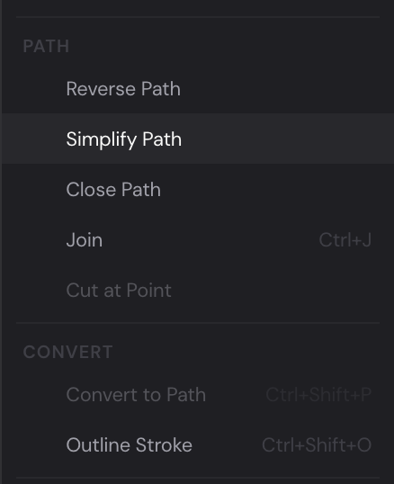

A path is a line through points. Between two points it runs straight, or it
curves, pulled by the points' handles. Closed, it's a shape you can fill; open,
it's a line with a stroke. This chapter shows how to draw paths with the Pen,
reshape any path point by point, and cut, join and combine them.

## Draw with the Pen {#pen}

1. Press [[P]] for the Pen, or click it in the toolbar.
2. Click on the canvas to place a corner point, where the path turns sharply.
3. Click again for the next point. To curve the path through a point instead,
   press and drag: you pull out the point's two handles, and the path bends
   smoothly through it.
4. Go on, a click or a drag for each point. A dashed line runs from the last
   point to the pointer, where the next part will go.
5. Finish the path:
   - To close it, click its first point. A closed path is filled.
   - To leave it open, press [[Enter]]. An open path has only its stroke.

The path is selected, and the editor is back on the Selection tool ([[V]]).

1. **The first point.** Click it to close the path.
2. **A handle.** A smooth point has two, in line; the longer a handle, the
   further the curve leans its way.
3. **The line to the pointer**, showing where the next point goes.

While you draw:

- Hold [[Shift]] to put the next point at a multiple of 45° from the last
  one: straight across, straight up or down, or diagonal. While you drag out
  handles, [[Shift]] holds them at 45° steps.
- Hold [[Alt]] while you drag out handles to move only the one going forward.
  The point becomes a corner, so the path can leave it in a new direction.
- [[Alt]]-click a point of the path you're drawing to switch it between corner
  and smooth.
- Press [[Backspace]] or [[Delete]] to take away the last point.
- Press [[Esc]] to throw away the path you're drawing.

Choosing another tool finishes the path, open, if it has two points or more.

A new path's stroke is 2 pixels wide, black or near white, whichever stands
out against what's behind it, and a closed path is filled cornflower blue, as
new shapes are.

### Carry on an open path {#continue}

Point the Pen at either end of an open path: a small slash appears beside the
pointer. Click there and carry on drawing from that end, then press [[Enter]]
to finish, or click the path's other end to close it.

### Add and take away points with the Pen {#pen-points}

Select a path, then choose the Pen and point at the path:

- On a segment, a **+** appears beside the pointer: click to add a point there.
  The curve keeps its shape.
- On a point, a **−** appears: click to take the point away. A path keeps at
  least two points. (At an open path's ends, a click carries the path on
  instead.)

## Reshape a path with Direct Selection {#direct-selection}

The Selection tool moves whole layers; Direct Selection ([[A]]) moves their
points.

1. Press [[A]] for Direct Selection, and click a path: its points appear. (Or
   double-click a path with the Selection tool.)
2. Click a point to pick it. Its handles appear, and the **Vertex** section in
   the Properties panel shows its settings (see [The Vertex section](#vertex)).
3. Drag the point to move it.

1. **A picked point**, in violet. The other points are white.
2. **One of its handles.**
3. **Where the point is.**
4. **What type of point it is.**
5. **Where its handles are.**

With Direct Selection you can:

- **Pick several points.** [[Shift]]-click to add a point to the ones picked,
  or to take it away. Drag across an empty part of the canvas to pick every
  point inside the box ([[Shift]] adds them to the ones picked). [[Mod+A]]
  picks every point of the selected paths.
- **Move them.** Drag one of the picked points, and the others move with it.
  The point you drag snaps onto any other point it comes near, and onto the
  grid and the guides when **Snap to Grid** and **Snap to Guides** are on in the
  View menu. The arrow keys move picked points 1 pixel, or 10 with [[Shift]]
  (a grid square when snapping to the grid).
- **Curve a segment.** Drag a handle. On a smooth point the other handle turns
  with it; hold [[Alt]] to move one handle on its own, which makes the point a
  corner. Or drag a segment itself to bend it.
- **Add a point.** Double-click a segment. The curve keeps its shape.
- **Switch a point** between corner and smooth: [[Alt]]-click it.
- **Delete points.** Press [[Delete]] or [[Backspace]]. A path left with fewer
  than two points is deleted.

Press [[Esc]] while you drag to put things back where they were. Otherwise,
[[Esc]] lets go of the picked points, and pressing it again goes back to the
Selection tool.

Right-click with points picked to cut the path there, join paths or delete the
points (see [Path commands](#path-commands)).

> [!TIP]
> Click a rectangle, an ellipse, a polygon or a star with Direct Selection and
> it becomes a path, with all its points picked, ready to reshape. It stays the
> same layer and keeps its animation, but it's a path from then on: its corner
> radius, sides and so on are gone.

To reshape a path inside a group, click the group to select it, then click it
again to go inside: its paths' points can be picked. With no points picked,
[[Esc]] takes you back out.

> [!NOTE]
> Direct Selection doesn't pick the points of a shape that's inside an
> artboard: clicking one there selects the artboard. To reshape it, drag its
> layer out of the artboard in the Layers panel, reshape it, then drag the layer
> back onto the artboard. It keeps its place on the canvas both ways (see
> [Put layers in an artboard](artboards.md#layers)).

## The Vertex section {#vertex}

With points picked, the Properties panel shows a **Vertex** section:

- **X** and **Y**: where the point is, in the path's own coordinates (they
  move, turn and scale with the layer). With several points picked, the fields
  show the first one's, and a value you type goes to all of them, which lines
  them up.
- **Type**: **Corner** (its handles move on their own), **Smooth** (they stay
  in line) or **Symmetric** (in line, and the same length).
- **Handle in** and **Handle out**: where the point's handles are, from the
  point, when one point is picked. On a smooth point, the other handle turns
  with the one you change.
- **R** rounds the picked points' corners. It's there when every picked point
  is a corner.

The diamonds beside **X**, **Y** and **R** are for animating the point (see
[The diamonds in Properties](keyframes.md#diamonds)). To morph the whole
outline from one shape into another, key the path's **Shape** row under
**Transform** instead: see [Shape tweening](shape-tweening.md#morph).

## Path commands {#path-commands}

The commands for whole paths are in the **Edit** menu, under **Path**. They
work on the selected paths, and most of them are in the canvas's right-click
menu too.

- **Reverse Path** turns the path round: its last point becomes its first. It
  matters where the direction does: an animation that draws the path's stroke
  on, such as the [**Draw On** preset](presets-and-sequences.md#presets),
  starts from the other end.
- **Simplify Path** takes away points the path doesn't need, keeping its shape.
- **Close Path** joins the path's ends with a segment, and fills it if it had
  no fill. **Open Path**, in its place for a closed path, takes that segment
  away. An open path isn't filled: one without a stroke is given a stroke in
  its fill's color, so it stays in sight.
- **Join** ([[Mod+J]]) closes an open path, its ends becoming one point where
  they meet. With several open paths selected, it joins them end to end, the
  nearest ends first, into the one lowest in the Layers panel.
- **Cut at Point** cuts a path at the points picked with Direct Selection
  (not its ends), into open pieces. The first piece stays the layer, and the
  others become layers just above it, with its animation. It's in the
  right-click menu too, as **Cut Path Here**, once points are picked.

Paths whose points are animated are left as they are by **Simplify Path**, by
**Cut at Point**, and by **Join** when it joins several paths, since they'd lose
that animation; a message says so. A path with holes can't be cut.

## Convert shapes, strokes and text {#convert}

Under **Convert** in the **Edit** menu:

- **Convert to Path** ([[Mod+Shift+P]]) turns the selected rectangles,
  ellipses, polygons and stars into paths, so you can reshape them point by
  point. Each stays the same layer, with its name and its animation. Text
  becomes a group with one path for each letter (see
  [Turn text into shapes](text.md#convert)).
- **Outline Stroke** ([[Mod+Shift+O]]) turns the shape's stroke into a filled
  shape of its own, just above it, and takes the stroke off the shape. Then you
  can reshape the outline, or fill it with a gradient, as you would any shape.

## Overlapping contours {#fill-rule}

A path can have several contours: the outline of a letter O and its hole, say.
Where they overlap, or where a path crosses itself, the **Fill rule** under a
path's fills decides what's filled:

- **Nonzero (overlaps filled)** fills overlaps, unless a contour runs the other
  way round, as a hole does.
- **Even-odd (overlaps make holes)** leaves every overlap empty.

## Combine shapes {#boolean}

Rectangles, ellipses, polygons and paths can be combined into new shapes.

1. Select two shapes or more (hold [[Shift]] and click them, or drag a box
   around them with the Selection tool: see
   [Select layers](selecting-and-arranging.md#select)).
2. Choose how to combine them, in the **Edit** menu under **Boolean**, in the
   right-click menu, or with the buttons under **Boolean Operations** in the
   Properties panel:
   - **Union** ([[Mod+Shift+U]]): one shape covering them all.
   - **Subtract** ([[Mod+Shift+D]]): the shapes above the lowest one are cut out
     of it.
   - **Intersect** ([[Mod+Shift+I]]): only where they overlap.
   - **Exclude** ([[Mod+Shift+X]]): everywhere they don't overlap.

The result is a [group](selecting-and-arranging.md#groups), named after what
it does (1), with the shapes inside it. It takes the lowest shape's fill and stroke, and you can change them as
you would a shape's. The shapes inside stay as they are: move or reshape one
and the result follows.

With the group selected, the Properties panel's **Boolean Operation** section
changes how it combines them. Its buttons, also in the Edit menu:

- **Flatten Boolean** makes the result one path, for good.
- **Release Boolean** takes the shapes out of the group, separate again.
