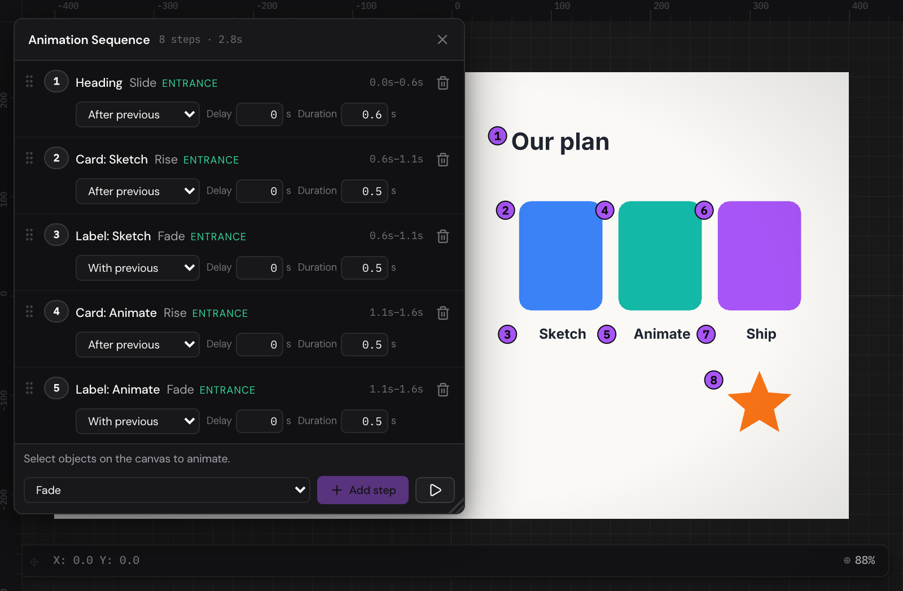

You don't have to set every keyframe yourself. The animation presets put a
whole effect — a fade, a pop, a bounce — on a layer with one click, as
ordinary keyframes you can change afterwards. The Animation Sequence window
goes further: it lines effects up in numbered steps, one after another or
together, the way slides build in a presentation, and keeps the timeline in
step as you reorder and retime them.

## Animate with a preset {#presets}

1. Select one or more layers.
2. Move the playhead to the frame where the effect should start.
3. In the Properties panel, under **Animation**, choose the effect's
   **Duration**.
4. Click an effect.

The effect's keyframes appear on the layer's row, starting at the playhead.
They're ordinary keyframes: move them, change their easing or delete them on
the timeline like any others. If the timeline is too short for the effect,
it's made longer.

The effects come in four groups:

- **Entrance:** Fade, Rise, Drop, Slide, Spin, Pop and Zoom In bring a layer
  into view. A path also has **Draw On**, which draws its stroke from start
  to finish (**Reverse Path** turns it round: see
  [Path commands](paths.md#path-commands)), and a [text](text.md#settings)
  has **Typewriter**, **By Word** and **By Line**, which reveal it a letter, a
  word or a line at a time.
- **Emphasis:** Pulse, Bounce, Shake, Wobble, Heartbeat, Flash and Rubber
  Band draw attention to a layer that's already there.
- **Loop:** Float, Sway, Breathing and Orbit make one cycle of a movement
  that can repeat.
- **Exit:** Fade, Shrink, Zoom Out, Slide, Spin, Rise Out and Drop Out take a
  layer out of view.

Point at an effect to see what it does. The panel only offers the effects
that suit everything selected.

### The preset settings {#preset-settings}

- **Duration:** how long the effect lasts: 0.4, 0.8, 1.2 or 1.6 seconds.
- **Direction:** where an effect that moves comes from or goes to — **Left**,
  **Right**, **Top** or **Bottom**. **Auto** uses each effect's own: Slide
  comes in from the left, Rise from below.
- **Intensity:** how strong the effect is, from 50% to 200%: how far it
  moves, how much it grows or turns.
- **Stagger per object,** there with several layers selected: each layer
  starts this much later than the one before, so they follow each other.

An effect replaces the keyframes its properties have from the playhead on,
and keeps those before it. An entrance applied after frame 0 keeps the layer
hidden until it begins.

> [!TIP]
> Tutorial 2 · Motion presets & sequences has a page of objects with presets
> applied. Select one to see its keyframes.

## The Animation Sequence window {#sequence}

The Animation Sequence window builds a page's animation as a list of
numbered steps: "the heading slides in, then the first card rises, with its
label fading in at the same time…". Each step is an effect on one layer.
You arrange the steps, and the editor works out the keyframes.

To open it, choose **View › Animation Sequence**, press [[Shift+A]], or click
**Animation Sequence** on the timeline's bar. To close it, do one of those
again, click its **×**, or press [[Esc]] while you're in it. Move it by its
title bar and resize it from its bottom-right corner; it opens where you left
it.

The title bar says how many steps there are and how long they take. While
the window is open, each object with steps has their numbers beside it on
the canvas; click a number to see the object's first step.

Each page has a sequence of its own.

### Add a step {#add-step}

1. Select the layer (or layers) on the canvas or in the Layers panel.
2. At the foot of the window, choose an effect.
3. Click **Add step**. With several layers selected it's
   **Add for 3 objects** and so on: one step for each, the first after the
   steps before and the others together with it.

While the window is open, clicking an effect under **Animation** in the
Properties panel adds a step too, with the panel's **Duration**,
**Direction**, **Intensity** and **Stagger per object**. The panel says
**Adds to sequence** then.

When **Add step** can't add anything, the line above it says why: nothing's
selected, say. For **Own keyframes** it also says what it will add (see
[below](#own-keyframes)).

**Play from start**, the button at the right of the window's foot, plays the
page from frame 0.

### Change a step {#step-settings}

Each step shows its number, its layer, its effect, and when it plays, in
seconds.

- **When it starts:** **After previous** (when the step before ends),
  **With previous** (when the step before starts), or **After #2**,
  **With #2** and so on, to time it against an earlier step of your choice.
- **Delay:** how many seconds after that it waits.
- **Duration:** how many seconds it lasts.
- **Repeat,** for Loop effects and steps of your own keyframes: how many
  times it plays (1×, 2×, 3×, 4×, 5× or 10×), or **Until end**, to the end of
  the timeline. Steps that come after a step that repeats until the end start
  after its first time.
- **Reorder:** drag a step by its grip at the left, or press [[Alt+Up]] or
  [[Alt+Down]] in it.
- **Go to it:** click the layer's name in the step. The layer is selected
  and the playhead goes to where the step starts.
- **Remove it:** click its bin.

Steps playing at the playhead are highlighted, and so are the steps of the
selected layers.

### Make a step of your own keyframes {#own-keyframes}

An animation you've keyed yourself can be a step too, timed and reordered
with the rest:

1. Animate the layer with keyframes (see
   [Keyframes and the timeline](keyframes.md)).
2. Select it.
3. In the window, choose **Own keyframes**, under **Hand-made**, at the top
   of the effects.
4. Click **Add step**. The line above the button says what it will do.

The step starts where the keyframes were, and you can change its start,
delay and duration like any step's; a longer duration stretches the
keyframes. If you remove the step, the keyframes stay on the timeline as
yours.

If a group or an artboard is selected, it's the keyframes of the layer itself
that count: the line above **Add step** tells you when they're on the layers
inside it, so you can select those instead.

## How steps become keyframes {#keyframes}

The sequence writes its keyframes onto the timeline, and writes them again
whenever you change a step. They're hollow diamonds on the timeline, and
hollow dots in the graph editor.

- They belong to the sequence, so you can't drag or delete them on the
  timeline. Click one and its step opens in the window, where you change it.
- Moving or turning a layer that has steps doesn't add keyframes: its whole
  animation moves with it, and the effects play from where you put it.
- **Delete Animation** on the timeline (see
  [Delete a layer's animation](keyframes.md#delete-animation)) removes the
  layer's steps too.
