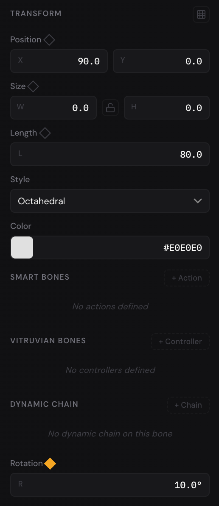

Bones let you pose artwork the way you'd pose a puppet. You draw a skeleton,
bind shapes and pictures to it, and turn the bones: the artwork bends with
them, smoothly at the joints. Bones are helpers. You see them while you work,
but they're never drawn in an export.

Tutorial 5 (Rigging) on the Projects page has a page for each step of this
chapter, so you can try them as you read.

## Draw bones {#draw}

1. Press [[J]] for the Bone tool. (It's also the last of the tools in the menu
   bar, and **Rigging › Bone Tool**.)
2. Drag from where the joint should be to where the bone should end. When you
   let go, the bone is there, called Bone 1.
3. Drag again. Wherever you start this drag, the new bone starts at the tip of
   the last one and becomes its child. Go on to make a chain.
4. Press [[Esc]] to end the chain. The editor goes back to the Selection tool.

- **Branch from a bone:** with the Bone tool, start a drag on the tip of any
  bone. The new bone starts there, as that bone's child: two arms from one
  shoulder, say.
- **Start another skeleton:** press [[Esc]] to end the chain, press [[J]]
  again and drag somewhere away from the other bones.
- **Rename a bone:** double-click its name in the Layers panel, type the new
  one and press [[Enter]]. Names like Upper arm and Hand make a rig easier to
  work with.

A very short drag (a few pixels on screen) makes no bone.

## Pose bones {#pose}

1. Select a bone with the Selection tool ([[V]]): click it on the canvas, or
   its name in the Layers panel.
2. Point just outside a corner of the box around it. The pointer turns into a
   curved arrow.
3. Drag to turn the bone around its joint. The bones after it in the chain
   turn with it.

To move a whole skeleton, drag its first bone.

A bone's **Rotation**, in the Properties panel, is measured from its parent
bone: a child bone at 0° carries straight on from its parent, and turning the
parent doesn't change it. The first bone of a chain has no parent bone, so its
angle is measured from the horizontal (or from the group or artboard it's in).

A bone's own settings are under **Transform**:

- **Length**: how long the bone is. Changing it moves the bones after it.
- **Style**: **Octahedral** (the diamond shape) or **Stick** (a thin line),
  only how the bone is drawn.
- **Color**: the bone's color on the canvas.

**Smart Bones**, **Vitruvian Bones** and **Dynamic Chain** are covered in
the chapter on IK, physics and Smart Bones.

### Animate a pose {#animate}

Bones take keyframes like any other layer: their **Rotation** and **Length**
have keyframe diamonds. Press [[K]] to turn on auto-keyframe, move the
playhead to a frame, and turn the bones: each turn adds a rotation keyframe
there. The first page of Tutorial 5 plays an arm animated this way.

## Bind shapes and pictures {#bind}

A shape bound to bones bends as they turn.

1. Draw the bones over the artwork, posed as the artwork is drawn. That pose
   is the one the artwork rests in.
2. Select the shape or picture (or several).
3. Choose **Rigging › Bind Selection to Bones**, or right-click it and choose
   **Bind to Bones**.

It's bound to every bone on the page. The editor works out how strongly each
bone pulls on each part of it, from where the bones are: each part follows
the bones nearest it, blending between two bones at a joint. Now turn a bone,
and the shape bends.

A bound shape or picture bends smoothly along its length, not only at its
corners: the editor fills it with small triangles, and each follows the bones
near it.

- Rectangles, ellipses, polygons and stars, paths and pictures can be bound.
  Text can't: turn it into paths first with **Convert to Path**
  ([[Mod+Shift+P]]).
- To bind the shapes and pictures in a group, right-click the group and
  choose **Bind to Bones**.
- **Bind Selection to Bones** is greyed out until the page has a bone and a
  shape or picture is selected.
- A bound layer has a **Rigging** section in the Properties panel: how many
  bones it's **Bound** to, a **Bone** list, and the **Weight Paint** and
  **Unbind** buttons. The next chapter is about weights.

If a part of the shape follows the wrong bone, you can change how strongly
each bone pulls with the Weight Paint tool.

### Unbind {#unbind}

To make a bound layer its own again, select it and do one of these:

- choose **Rigging › Unbind Mesh**;
- right-click it and choose **Unbind Mesh**;
- click **Unbind** in its **Rigging** section.

It goes back to its shape as drawn, and the bones no longer move it.

## Copy, paste and delete rigged layers {#copy-delete}

Copying and deleting keep a rig working:

- **Copy bones together with their artwork**, and the copy is a rig of its
  own: the pasted shapes are bound to the pasted bones. The IK chains, dynamic
  chains and Smart Bone actions among the copied bones come with them.
- **Copy a bound shape without its bones**, and the copy is bound to the same
  bones as the shape it came from.
- **Delete a bone**, and the bones after it in its chain go too (they're
  inside it). Shapes bound to it stay bound to the bones that are left; a shape
  left with no bones is unbound. An IK chain that loses a bone goes, with its
  target, and so do the dynamic chains and Smart Bone actions of a deleted
  bone.

## Undo {#undo}

Drawing a bone, turning one, binding and unbinding are each a step you can
undo with [[Mod+Z]] and redo with [[Mod+Shift+Z]]. Like everything else, a
page's rigging has its own history: see
[Undo and redo](getting-started.md#undo).
