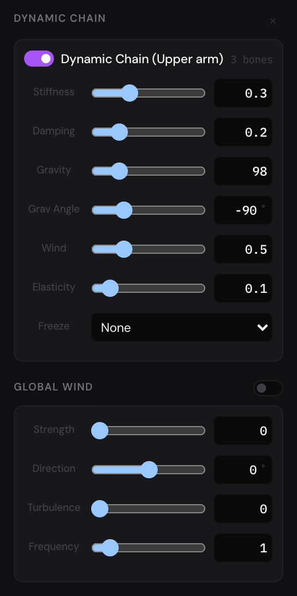

Once a skeleton is drawn and bound (see
[Bones and binding](rigging-bones.md)), these tools make it easier to pose and
more alive: IK poses a chain from its end, dynamic chains swing by
themselves, Smart Bones reshape a bound shape as a bone turns, and Vitruvian
controllers switch between sets of bones.

All of them are in the **Rigging** menu, and all but IK have a section in a
selected bone's Properties panel. Exports show what they do, as the canvas
does, though the bones themselves are never drawn.

## Pose with IK {#ik}

IK (inverse kinematics) poses a chain by its end: drag the hand, and the arm
follows.

1. Select the last bone of the chain: the hand, say.
2. Choose **Rigging › Create IK Chain**, or right-click the bone and choose
   **Create IK Chain**.
3. A target appears at the bone's tip, selected: a layer called IK Target
   (Hand), listed in the [Layers panel](selecting-and-arranging.md#layers)
   like any other, in the artboard or group that holds the skeleton (so its
   keyframes go on that artboard's timeline). Drag it, and the bones of the
   chain turn to reach it.

- The chain runs up from the bone you chose to the first bone of the
  skeleton, or to the bone where the skeleton branches, whichever comes
  first: the hand of one arm doesn't bend the body both arms hang from.
- A bone can be in only one IK chain.
- If the target is out of reach, the chain stretches out towards it.
- To turn a chain off and on, select its target and clear or tick
  **Enabled** in the **IK Chain** section of the Properties panel. The
  section names the chain's bones, as IK Chain (Upper arm → Forearm → Hand).
- To remove a chain, select its target, or the first or last bone of the
  chain, and choose **Rigging › Remove IK Chain** (or right-click it:
  **Remove IK Chain**). Its target goes with it.

### Animate with IK {#ik-animate}

Animate the target, and the chain follows it:

1. Press [[K]] to turn on [auto-keyframe](keyframes.md#auto-keyframe).
2. Move the playhead to a frame, and drag the target. Its position gets a
   keyframe there.
3. Do the same at the other frames of the move, then press [[Space]] to play.

While a chain is enabled, its bones point where its target says, whatever
their own rotation keyframes say. Clear **Enabled** to see them play their
keyframes again.

## Swing with physics: dynamic chains {#dynamic-chains}

A dynamic chain makes bones swing by themselves: a tail, hair or a scarf that
lags behind, then settles, as what it hangs from moves.

1. Select the bone the chain starts from.
2. Choose **Rigging › Create Dynamic Chain**, or click **+ Chain** in the
   **Dynamic Chain** section of the Properties panel.
3. Press [[Space]] to play.

The chain is that bone and the bones after it, following each one's first
child. It hangs from the first bone's joint: when that moves, the bones swing
behind it, pulled by gravity and the wind, and settle back towards the pose
they had when you pressed play.

Physics only moves the bones while the timeline plays. When you stop, they
go back to their own rotations, and the next play starts afresh. Exports work
it out too, a step for each frame they show.

A chain's settings, in the **Dynamic Chain** section of any of its bones:

- The switch beside its name turns it off and on.
- **Stiffness**: how strongly each bone turns back towards its pose.
- **Damping**: how quickly the swinging dies down.
- **Gravity**: how strongly the bones are pulled; **Grav Angle**: which way,
  in degrees (−90° is straight down).
- **Wind**: how much the wind moves this chain.
- **Elasticity**: how strongly the bones spring back to where they rest.
- **Freeze**: **X Axis** stops the bones moving sideways, **Y Axis** up and
  down.

To remove a chain, click the **×** at the top of its section, or select its
first bone and choose **Rigging › Remove Dynamic Chain**.

### Wind {#wind}

Once there's a dynamic chain, a selected bone's Properties panel also shows
**Global Wind**: one wind for every dynamic chain in the project. Turn it on
with the switch beside its title, then set:

- **Strength**: how hard it blows.
- **Direction**: which way it blows, in degrees (0° is to the right, 90° up).
- **Turbulence**: how much it wavers in strength and direction.
- **Frequency**: how many times a second it wavers.

## Reshape with Smart Bones {#smart-bones}

A Smart Bone action reshapes bound shapes as a bone turns: an elbow that
keeps its thickness when it bends, a muscle that bulges. You shape them at
one angle or a few, and between those the editor blends.

1. Bind the shapes to the bones first.
2. Select the bone whose turning drives the change: the forearm, say.
3. Choose **Rigging › Create Smart Bone Action**, or click **+ Action** in
   the **Smart Bones** section of the Properties panel. A card called Smart
   Bone 1 appears.
4. Set its range (1): **Min** is the bone's rotation where the shapes are as
   you bound them, **Max** where the change is complete, in degrees.
5. Type an angle under **Targets** (2), 90 say, and click **+**. The target
   is listed as Target at 90°. (Leave the field empty, and the target is at
   the middle of the range.)
6. Click **Rec** beside the target. The bone turns to the target's angle and
   the Point Magnet comes on: drag over the shapes to push them into the
   shape you want at that angle. See
   [The Point Magnet](rigging-weights.md#point-magnet) for its keys.
7. Click **Stop** (3). The target keeps the new shape, and the bone goes back
   to the rotation it had. Choosing another tool stops the recording too.

Now turn the bone. From **Min** to the first target, the shapes change into
the target's shape; between two targets they blend from one to the other;
past the last target, they keep its shape.

- The switch on the card turns the action off and on; its **×** deletes it.
  With the bone selected, **Rigging › Delete Smart Bone Action** deletes its
  action too.
- The **×** beside a target removes it.
- **Min** can be more than **Max**, for a change that comes as the bone turns
  the other way.
- A bone's angle counts the same a whole turn either way: −340° is 20°.
- Smart Bones work as the animation plays, and in exports.
- A recording, from **Rec** to **Stop**, is one step you can undo.

## Switch sets of bones: Vitruvian controllers {#vitruvian}

A Vitruvian controller switches between sets of bones: one set for a
character seen from the front, another for its side view, say. Only the bones
of the set chosen are shown on the canvas, and each set can bring back the
bindings it was given.

1. Select a bone and choose **Rigging › Create Vitruvian Controller**, or
   click **+ Controller** in the **Vitruvian Bones** section. The
   controller, Vitruvian 1, has one group, Default, with no bones.
2. Put bones in a group: select a bone and tick the checkbox at the start of
   the group's row. Clear it to take the bone out.
3. Click **+** beside **Groups** to add another group (Group 2) with the
   selected bone in it.
4. Bind and paint the shapes as a group needs, then click **Snap** on its
   row: the group keeps a copy of every bound layer's binding.
5. Choose a group under **Active**. The bones of the controller's other
   groups are hidden, and the group's snapped bindings come back. The group
   you leave keeps its bindings as they are then, weights painted meanwhile
   included.

- Bones in none of a controller's groups always show.
- The switch beside the controller's name turns it off, and every bone
  shows again.
- The **×** on a group's row deletes the group; the **×** beside the
  controller's name deletes the controller. **Rigging › Remove Vitruvian
  Controller** removes the last one made.
