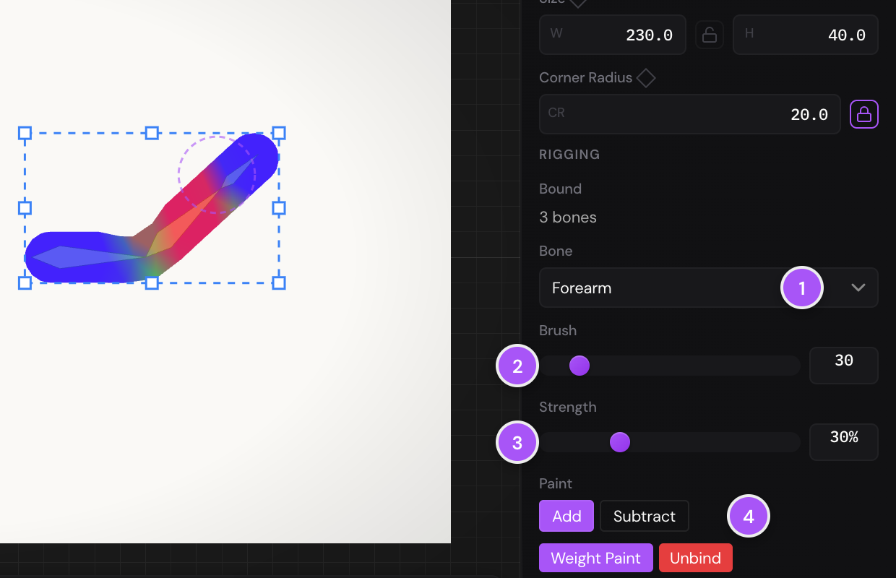

When you bind a shape to bones, the editor decides how strongly each bone
pulls on each part of it. Those amounts are its weights. Most of the time the
weights it works out bend a shape well; where they don't (a sleeve that
tears at the elbow, a body that follows an arm), you paint them by hand.

This chapter starts where [Bones and binding](rigging-bones.md#bind) leaves
off, with a shape bound to bones. Page 2 of Tutorial 5 · Rigging has a shape
to bind and paint.

## The weights binding gives you {#auto-weights}

When you bind, each part of the shape goes to the bone nearest it. Near a
joint, it blends from one bone to the next, so the shape bends smoothly
there. How far the shape reaches round each bone counts too: a body keeps the
parts under an arm drawn across it, though they're near the arm's bone.

The weights of each part always add up to 100%: a point half on the upper
arm is half on the bones next to it.

## Paint weights {#weight-paint}

1. Select a bound shape or picture (or a group with bound layers in it).
2. Press [[W]] for the Weight Paint tool. It's also
   **Rigging › Weight Paint Tool**, the **Weight Paint** button in the
   **Rigging** section of the Properties panel, and **Weight Paint** in the
   right-click menu of a bound shape.
3. In the **Rigging** section, choose the bone to paint under **Bone** (1).
   The shape shows that bone's weights in color: red where the bone pulls
   with all its strength, green where it pulls with half, blue where it
   doesn't pull at all.
4. Drag over the shape to paint more of that bone's weight on.

The brush's settings are in the **Rigging** section while you paint:

1. **Bone**: the bone you're painting.
2. **Brush**: the brush's size, from 5 to 200. <kbd class="keys"><kbd>[</kbd></kbd> and <kbd class="keys"><kbd>]</kbd></kbd> make it
   smaller and larger.
3. **Strength**: how much each pass of the brush adds or takes away, from 1%
   to 100%.
4. **Paint**: **Add** puts more of the bone's weight on, **Subtract** takes it
   off. [[X]] switches between them.

The keys work while the canvas has the focus: once you've painted on it.
The line at the bottom left of the canvas says which bone you're painting
and whether you're adding or subtracting.

- The brush is strongest in its middle and fades towards its edge.
- When you paint a bone's weight on, the other bones' weights there shrink to
  make room; when you take it off, they grow to fill the gap.
- The brush paints the shape where the bones have bent it. Pose the bones
  first, and you can see a bad bend get better as you paint.
- Each stroke is a step you can undo with [[Mod+Z]].
- To stop painting, choose another tool, such as Selection ([[V]]).

If no bound layer is selected, the editor says "Select a layer bound to bones
to weight paint it" and switches to the Selection tool.

## Edit a bound shape {#edit-bound}

You can change a shape after you've bound it: its size, its corner radius,
its points. Its weights carry over: each part of the changed shape takes the
weights of the parts of the old shape nearest it, so it goes on bending as
before. You don't need to bind it again.

To work on a bound path's points, select the path and press [[A]] for
[Direct Selection](paths.md#direct-selection). Its points are shown where the bones have bent it, not where they
are at rest.

## The Point Magnet {#point-magnet}

The Point Magnet is the brush Smart Bones use. It isn't in the toolbar: it
comes on by itself while you record a Smart Bone target, and goes when you
stop (see [Reshape with Smart Bones](rigging-ik-physics.md#smart-bones)). "Smart Bone Recording" shows at the bottom left
of the canvas, and a red dashed circle is the brush.

- Drag over bound shapes to push their points the way you drag. Points near
  the middle of the brush move most.
- <kbd class="keys"><kbd>[</kbd></kbd> and <kbd class="keys"><kbd>]</kbd></kbd> make the brush smaller and larger.
- [[F]] changes how its push fades towards its edge: smooth, then straight
  (linear), then not at all (the same push across the whole brush), then
  smooth again.
- [[Esc]] clears what the target you're recording holds, so you can start it
  over.

As with the Weight Paint tool, the keys work once you've dragged on the
canvas.
