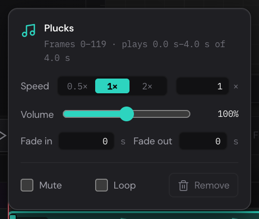

Music, a voice-over or sound effects make an animation come alive, and
timing a move to a sound is easier when you can hear it. Sounds go on the
timeline as clips, in the Sound lane below the layers. They play with the
animation in the editor, and go into MP4 and WebM videos you export.

## Add a sound {#add}

Do one of these:

- Choose **File › Import Sound…** and pick one or more sound files. They go
  on the timeline at the playhead.
- Click **+** on the Sound lane, at the left of the timeline. That also puts
  them at the playhead.
- Drop sound files on the timeline. While you drag them over it, a marker
  shows the frame under the pointer, and they start there.
- Drop sound files on the canvas. They go at the playhead.
- Right-click an empty part of the Sound lane and choose
  **Import Sound at Frame**, to start them at the frame you clicked.

MP3, WAV, OGG, Opus, M4A, AAC, FLAC and WebM sound files work, if your
browser can play them, up to 50 MB each. A message at the bottom right says
what was added. If the timeline is too short to play the sound to its end,
it's made longer, and the message says so.

The sound is kept in the project, so it goes with the project into
`.quar` backups (see [Keep a backup](getting-started.md#backups)).

> [!NOTE]
> A sound goes on the timeline in view: the page's, or an artboard's (see
> [Each artboard has its own timeline](artboards.md#timelines)). Each
> timeline has sounds of its own.

## The Sound lane {#lane}

1. **Hear sounds while scrubbing:** see [Hear it as you scrub](#scrub).
2. **Import sound** (**+**): adds sound files at the playhead.
3. **A clip:** the sound's name and its waveform, drawn as loud as it plays.
   Where clips play at the same time, they sit one under another.
4. **A fade:** the clip's sound grows from silence here.

Point at a clip to see its frames and length.

## Move and trim a clip {#move}

- **Move it:** drag the clip along the lane. It moves a frame at a time.
- **Trim it:** drag its left or right end. Trimming the left end starts the
  clip later in the sound; trimming the right end stops it sooner. Drag an
  end back out to hear more of the sound again, up to the whole of it.

Click a clip to select it. Then:

- [[Left]] and [[Right]] move it a frame; with [[Shift]], 10 frames.
- [[M]] mutes it, or turns its sound back on.
- [[Enter]] opens its settings.
- [[Delete]] or [[Backspace]] takes it off the timeline.

Right-click a clip for **Sound Settings…**, **Mute** (or **Unmute**) and
**Delete**. **Edit › Undo** takes back changes to clips.

## Volume, fades and mute {#settings}

Double-click a clip to open its settings.

- The top line says which frames the clip plays on, and which part of the
  sound it plays.
- **Volume:** from 0% to 200%. 100% is the sound as it is.
- **Fade in** and **Fade out:** how many seconds the sound takes to grow
  from silence at the start, and to die away at the end. Type a number and
  press [[Enter]].
- **Mute:** silence the clip without taking it away. A muted clip is dimmed,
  with a speaker crossed out before its name.
- **Remove:** take the clip off the timeline.

Press [[Esc]] or click outside the settings to close them.

You can also fade a clip on the lane itself: drag its top-left corner to
the right to fade it in, and its top-right corner to the left to fade it
out. The fade is drawn on the clip, and the waveform follows it.

## Hear your sounds {#playing}

Press [[Space]] to play. The sounds play in step with the frames.

Playing goes on until the last sound ends, even when that's after the last
keyframe. With a work area, only the sounds in it play (see
[The work area](keyframes.md#work-area)). When you present the artboards as
slides, each plays its own sounds (see [Present](presenting.md#present)).

### Hear it as you scrub {#scrub}

While the animation is stopped, dragging the playhead or stepping with
[[,]] and [[.]] plays a moment of the sounds at each frame, so you can find
the frame where a beat or a word lands.

To turn this off, click the headphones on the Sound lane. Click again to
turn it back on. The editor remembers your choice in this browser.

## Sound in videos {#export}

[MP4 and WebM exports](exporting.md#video) have a **Sound** option, there
when the timeline has sound clips: **With its sound clip** (or **With its 2
sound clips**, and so on). It's ticked unless you untick it. The clips play in the video as they
do in the editor, with their volume and fades; muted clips stay silent. GIFs
and the other exports have no sound.
