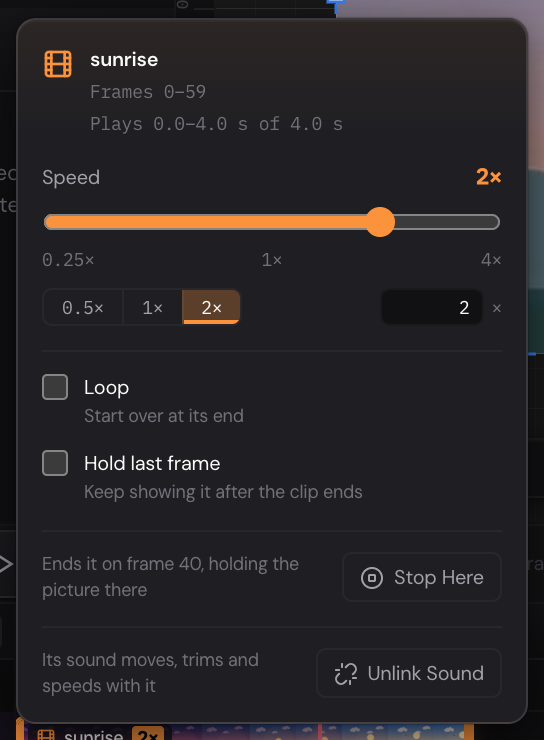

A video comes in as a layer on the canvas, to place, size and animate like a
picture. Its clip, a bar on the layer's row of the timeline, says when it
plays: move and trim it there. If the video has sound, the sound goes on the
Sound lane and stays with it. Animated GIFs come in the same way, as clips
without sound.

1. **The video layer** in the Layers panel, marked with a strip of film.
2. **The video** on the canvas, showing the frame at the playhead.
3. **Its clip** on the layer's row of the timeline.
4. **Its sound** on the Sound lane, linked to the video.
5. **The Video section** of the Properties panel.

## Import a video {#import}

Do one of these:

- Choose **File › Import Video…** and pick one or more files.
- Drop video files on the canvas.
- Drop video files on the timeline. While you drag them over it, a marker
  shows the frame under the pointer, and their clips start there.
- For an animated GIF, you can also choose **File › Import Image…**, or drop
  it on the canvas. A GIF that doesn't move comes in as a picture.

MP4 and MOV videos (H.264, or HEVC where your browser can play it), WebM
videos (VP8, VP9 or AV1) and animated GIFs work, up to 100 MB each.

While a video comes in, a message at the bottom right shows how far it has
got. Then it says what was added, and whether its sound came with it.

- The video is fitted to the artboard in view, centred, and goes into it:
  the artboard whose timeline the timeline shows, or else the one in the
  middle of the canvas. Outside artboards, it's fitted to most of the canvas
  view.
- Its clip starts at the playhead (dropped on the timeline: at the frame you
  drop it on) and plays the whole video once.
- If the timeline is too short to play it to its end, the timeline is made
  longer, and the message says so.
- The new layer is named after the file, and selected.

**Edit › Undo** takes the whole import back in one step. Videos can't be
imported while you're [editing a symbol](symbols.md#edit).

### When a video won't come in {#problems}

If a file can't be used, a message names the problem and what to try:

- **Too large:** a video can be up to 100 MB. Make it shorter or smaller in
  a video app first.
- **Not a video the editor can read:** try an MP4 file made with H.264.
- **This browser can't decode its video:** browsers don't all play the same
  kinds of video (HEVC and ProRes, for two). Try an MP4 made with H.264, or
  another browser.
- **Sound but no pictures:** use **File › Import Sound…** for it (see
  [Sound](sound.md#add)).
- **A still picture, not an animated GIF:** use **File › Import Image…**.
- **This browser can't show its transparency correctly:** a transparent
  WebM in Firefox. See [Transparent video](#transparency).

If the browser can't play a video's sound, the video comes in without it,
and a message says so.

## What a video layer can do {#layer}

A video layer works much like a [picture](pictures-and-svg.md):

- Move, resize and turn it with the Selection tool, or type its
  **Position**, **Size** and **Rotation** (see
  [Move, resize and rotate](selecting-and-arranging.md#transform)).
- Fade it with **Opacity**, round its corners with **Corner Radius**, and
  change its colors with the [**Adjustments**](pictures-and-svg.md#adjust).
- Give it [shadows and blur](masks-and-effects.md#effects) and a
  [blend mode](masks-and-effects.md#blend).
- [Mask](masks-and-effects.md#masks) it with a shape, or let its artboard
  [clip](artboards.md#clip) it.
- Animate all of these with [keyframes](keyframes.md#animate). The clip's
  timing has no keyframes: you set it on the timeline.

Before its clip starts and after it ends, the layer shows nothing (unless it
[holds its last frame](#settings)). While you look at another artboard's
timeline, it shows its clip's first picture.

While you scrub, the canvas can show a blurrier picture for a moment, until
the exact frame has been decoded.

A video layer can't have its corners pulled with Direct Selection, be bound
to bones, or go into a [symbol](symbols.md). Copy, paste and duplicate work
in the same window, its sound with it; videos can't be pasted into another
window or project: import the file there.

## The clip on the timeline {#clip-bar}

A video layer's row of the timeline holds its clip: a bar with a strip of the
video's pictures, from the frame it starts on to the frame it ends.
Keyframes on the row sit on top of it, and you can still click them.

1. **The clip:** its name and a strip of its pictures.
2. **The speed tag,** there when it plays faster or slower than 1×.
3. **Where a looped clip starts over.** A loop sign after its name says it
   loops.
4. **A held last frame:** the clip's last picture, shown to the end of the
   timeline.
5. **Its sound,** with a link sign before its name.

Point at a clip to see its frames and length.

- **Move it:** drag the bar along the row. It moves a frame at a time, and
  its sound moves with it. Clicking the bar selects the layer.
- **Trim it:** drag its left end to start later in the video, its right end
  to stop sooner. Drag an end back out to play more of it, up to the whole
  video.
- **Make a looped clip longer:** with **Loop** on, drag its right end past
  the video's end. The video plays over again until there.

If you drag a clip past the end of the timeline, the timeline grows to fit
it when you let go. Each drag is one step for **Edit › Undo**.

Playing goes on until the last clip ends, as it does for sounds. A video
plays at its own pace whatever the project's
[**FPS**](keyframes.md#frames-and-fps): at a higher frame rate, its clip
covers more frames.

After a click on the bar, [[Left]] and [[Right]] move the clip a frame (with
[[Shift]]: 10 frames), and [[Enter]] opens its settings.

Right-click the bar, or its row, for **Clip Settings…** and
**Stop Clip at Playhead** (see [below](#stop)), then the row's usual commands.

## Clip settings {#settings}

Double-click the bar to open its settings.

- The top lines say which frames the clip plays on, and which part of the
  video it plays.
- **Speed:** from 0.25× (four times slower) to 4× (four times faster). Drag
  the slider, click **0.5×**, **1×** or **2×**, or type a number and press
  [[Enter]]. A faster clip is shorter on the timeline, a slower one longer. Its
  sound changes speed too, and keeps its pitch.
- **Loop:** the clip starts over at its end. Turning it on doesn't make the
  clip longer: drag its right end out.
- **Hold last frame:** keep showing the clip's last picture after it ends, to
  the end of the timeline.
- **Stop Here:** see [Stop a clip](#stop).
- **Unlink Sound:** there while the clip has its sound (see
  [Its sound](#sound)).

Each change is a step you can undo. Press [[Esc]] or click outside the
settings to close them.

### Stop a clip on a frame {#stop}

1. Put the playhead on the frame where the clip should stop.
2. Click **Stop Here** in the clip's settings, or right-click the clip and
   choose **Stop Clip at Playhead**.

The clip ends on that frame and holds the picture showing there. It works on
a looped clip too, part way through a pass. The commands are greyed out
while the playhead isn't on the clip.

## Its sound {#sound}

A video's sound goes on the [Sound lane](sound.md#lane), starting where the
clip starts, with a link sign before its name. It's linked to the video:

- Moving, trimming or changing the speed of the clip does the same to the
  sound, and it loops with it.
- Moving, trimming or changing the speed of the sound on the Sound lane
  does the same to the video.
- Its **Volume**, fades and **Mute** are its own: double-click it on the
  Sound lane (see [Volume, fades and mute](sound.md#settings)).

To move them apart, unlink them: click **Unlink Sound** in the clip's
settings, or right-click the sound and choose **Unlink from Video**. The
sound is then a sound clip of its own.

Deleting a video whose sound is linked asks what to do with the sound:

**Keep Sound** keeps it on the Sound lane, unlinked; **Delete Sound** deletes
it too. [[Esc]] keeps it.

## The Video section {#properties}

Select a video layer, and the Properties panel has a **Video** section under
**Transform**.

- At the top, the video's first picture.
- **File**, **Length** and **Size:** the video's name, how long it is, and
  its width and height in pixels.
- **Alpha · Transparent:** there when the video has see-through parts.
- **Starts:** the frame the clip starts on. Type a frame and press
  [[Enter]], or press [[Up]] and [[Down]] (with [[Shift]]: 10 frames).
- **Speed:** **0.5×**, **1×** or **2×**, or type a speed from 0.25 to 4.
  [[Up]] and [[Down]] change it by 0.05 (with [[Shift]]: 0.25).
- **Loop** and **Hold last frame**, as in the [clip's settings](#settings).
- **Plays:** how long the clip plays, in time and in frames.
- **Part:** the part of the video it plays, from and to, then the video's
  length, or "looped".

To trim the clip, drag the ends of its bar on the
[timeline](#clip-bar).

## GIF clips {#gif}

An animated GIF plays the way its file says:

- A GIF that loops forever loops to the end of the timeline.
- One that plays a set number of times plays that many, then holds its last
  frame.
- One that plays once holds its last frame after it.

A GIF has no sound. Its section in Properties is called **Video**, as a
video's is, and a GIF with see-through parts stays see-through.

To change how it plays, use its [clip settings](#settings):

- **Loop** off plays it once and holds its last frame (**Hold last frame**
  turns on with it; turn that off and it shows nothing after it ends).
- To stop it on any frame, put the playhead there and use
  [Stop Here](#stop), or drag its right end.

Frames the file asks to show for 10 milliseconds or less show for a tenth of
a second, as browsers show them.

> [!NOTE]
> Bringing in a very big GIF can take a while: the editor looks at each of
> its frames to find out whether any part is see-through.

## Transparent video {#transparency}

A WebM video made with VP8 or VP9 can have see-through parts. Chrome, Edge
and Safari show them; the Video section says **Alpha · Transparent**.
Firefox can't show them correctly, so it doesn't import a transparent video:
use another browser for it. A project that already holds one shows it wrongly
in Firefox.

Exports keep what's see-through: a [WebM](exporting.md#video) with
**Transparent** ticked, a PNG sequence, a sprite sheet and a GIF (where each
pixel either shows or doesn't). An MP4 has no transparency: the video is
drawn over the background.

## Export and present {#export}

- **MP4, WebM, GIF, PNG Sequence and Sprite Sheet** play the video, each
  frame exactly. The video's sound goes into MP4 and WebM videos with the
  other [sound clips](sound.md#export).
- **Lottie, SVG and PDF** can't play video. Each video layer is a still
  picture there, and the Export dialog warns you before you export. A Lottie
  file shows the clip's first picture in the frames you export, while the
  clip plays; an SVG or a PDF shows the frame it's of.
- The [**Export** section](exporting.md#export-selection) of the Properties
  panel makes a PNG of the frame at the playhead, and an SVG with a still of
  it.

When you import a video, the editor also keeps small pictures of it, a few
a second. If an export can't read a video (say, in a browser that can't play
it), it uses those instead. The file is still made, and the Export dialog
stays open to say which video it was.

When you [present](presenting.md#present) the artboards as slides, each
slide's videos play in step with it. The player waits a moment for their
first pictures before it starts.

## Saving {#saving}

A video is kept inside the project, so it goes into `.quar` backups (see
[Keep a backup](getting-started.md#backups)). A file is kept once, however
many layers show it. Nothing links back to the file on your computer.

Videos make projects big: see
[When saving fails](troubleshooting.md#saving) if saving stops working.

> [!CAUTION]
> In a Safari private window, a project with a video can't be saved: the
> browser won't store the file. Use **File › Download as .quar** to keep it,
> or work in an ordinary window.
